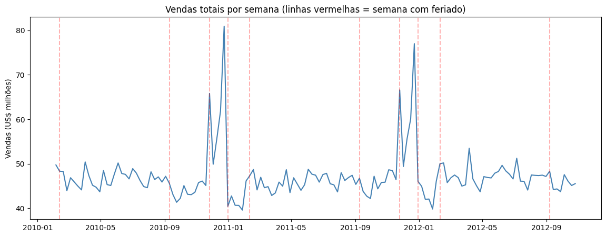
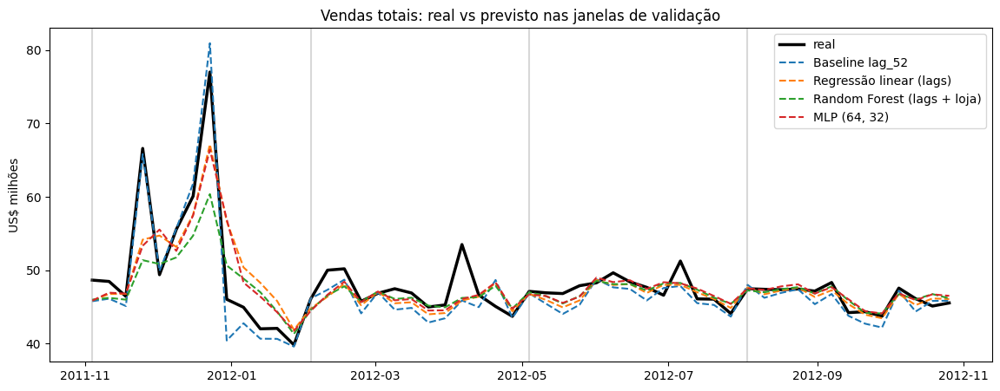
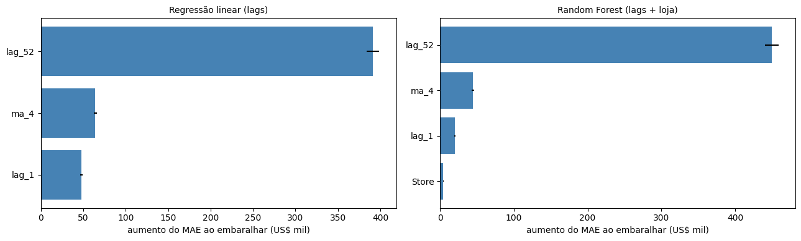

# Previsão de demanda semanal por loja

Trabalho final da disciplina Machine Learning Foundations and Classical Models, do MBA AI Engineering & Multi-Agents (FIAP).

## O case

A Quantum Commerce é a empresa do case proposto pela disciplina: uma varejista omnicanal presente em 12 países, com mais de 5 milhões de SKUs. Ela precisa decidir toda semana quanto estoque colocar em cada loja e quando reforçar transporte e equipe. Prever a menos causa ruptura e venda perdida. Prever a mais deixa capital parado em estoque.

O objetivo é prever a venda da semana seguinte de cada loja e avisar a logística quando vier um pico. Como não temos os dados da empresa, usamos o dataset de vendas do Walmart no lugar.

## Dados

[Walmart Dataset (Retail)](https://www.kaggle.com/datasets/rutuspatel/walmart-dataset-retail), do Kaggle: 45 lojas, vendas semanais de 05/02/2010 a 26/10/2012 (143 semanas por loja, 6.435 linhas), sem nulos. Além da venda, traz flag de feriado, temperatura, preço do combustível, CPI e desemprego.

O que a exploração mostrou:

- A sazonalidade anual é forte. Black Friday e a semana antes do Natal dominam a série. Na semana antes do Natal de 2011, a rede vendeu cerca de US$ 77 milhões, contra US$ 45 a 50 milhões numa semana comum.
- As lojas têm tamanhos muito diferentes: a venda média semanal vai de US$ 0,26 milhão a US$ 2,11 milhões.
- As variáveis externas têm relação fraca com a venda.
- A flag de feriado do Natal cai na semana depois do pico, e a Páscoa não é marcada.



## Abordagem

Tratamos a previsão como regressão: o alvo é a venda da semana, e as features são vendas passadas da própria loja, sem usar nada da semana prevista:

- `lag_1`: venda da semana anterior
- `lag_52`: venda da mesma semana do ano anterior
- `ma_4`: média das 4 semanas anteriores

Um único modelo atende as 45 lojas. Treino e teste são separados por data, nunca ao acaso. Comparamos dois baselines (repetir a semana passada e repetir o ano passado), regressão linear, Random Forest, Gradient Boosting e MLP, com e sem as variáveis externas.

## Resultados

No teste das últimas 30 semanas (abril a outubro de 2012), regressão linear, Random Forest, Gradient Boosting e MLP ficaram entre 4,3% e 4,5% de WAPE, contra 5,6% do melhor baseline. As variáveis externas não melhoraram a regressão linear nem as árvores.

Esse teste não tem Black Friday nem Natal. Por isso repetimos a comparação em 4 janelas de 13 semanas (walk-forward), em que cada janela treina só com o passado dela. A janela 1 inclui o fim de ano de 2011.

| Modelo | Janela 1 (Natal) | Janela 2 | Janela 3 | Janela 4 | Média |
|---|---|---|---|---|---|
| Baseline `lag_52` | 5,5% | 6,3% | 5,2% | 5,1% | 5,6% |
| MLP (64, 32) | 10,1% | 5,1% | 3,7% | 3,7% | 5,6% |
| Random Forest | 11,0% | 5,1% | 3,7% | 3,8% | 5,9% |
| Regressão linear | 10,4% | 5,5% | 4,0% | 3,8% | 5,9% |
| **Híbrido** | 7,1% | 5,5% | 4,0% | 3,8% | **5,1%** |

*WAPE: soma dos erros absolutos dividida pela soma das vendas reais.*



Nas semanas comuns, os modelos ganham do baseline. No Natal, perdem por quase o dobro: achatam o pico e carregam o erro para janeiro, porque `lag_1` e `ma_4` ainda trazem a venda alta das semanas anteriores. Repetir o ano anterior acerta o formato do pico.

A feature que mais pesa é o `lag_52`. Sem ele, o erro sobe de 8 a 10 vezes.



## Modelo proposto

Uma regra híbrida:

- De 15/11 a 31/12: a previsão é a venda da mesma semana do ano anterior.
- No resto do ano: regressão linear com pesos de 0,13 para `lag_1`, 0,72 para `lag_52` e 0,16 para `ma_4`.

Escolhemos a regressão linear porque Random Forest e MLP praticamente empataram com ela fora do pico (3,7% a 4,0% nas janelas 3 e 4), e com ela dá para explicar cada previsão. O híbrido teve o menor WAPE médio da validação (5,1%).

Para a logística, a previsão vira um alerta: se a venda prevista de uma loja passar de 1,2 vez a média das suas últimas 52 semanas, o sistema pede reforço de estoque. Na validação, esse alerta pegou 82% dos picos reais, e 92% dos alertas eram picos de verdade. A regressão linear sozinha pegava 56%.

## Limitações

- Os dados são dos EUA e há um único fim de ano na validação. A regra do híbrido foi definida depois de ver esse resultado e precisa ser confirmada em outros anos.
- A previsão é por loja e semana, sem produto nem categoria.
- O horizonte é de uma semana. Prever mais semanas à frente não foi testado.
- Feriados móveis, como a Páscoa, não ficam alinhados pelo `lag_52`.
- As lojas 36, 14, 38, 39 e 35 erram bem mais que as outras, e a causa não foi encontrada.

A lista completa está no [documento do trabalho](trabalho-final.md).

## Estrutura

```
previsao_demanda.ipynb   notebook com todas as etapas, da exploração à proposta
trabalho-final.md        documento entregue, com a análise completa
enunciado.md             enunciado do trabalho
plano-estudos.md         plano usado para conduzir as etapas do notebook
figuras/                 gráficos exportados do notebook
data/Walmart.csv         dados do Kaggle
```

## Como rodar

```bash
pip install pandas numpy matplotlib seaborn scikit-learn kagglehub
jupyter notebook previsao_demanda.ipynb
```

O notebook lê `data/Walmart.csv`. Se o arquivo não existir, ele baixa o dataset do Kaggle com o `kagglehub`. Todos os modelos usam `random_state=42`.
