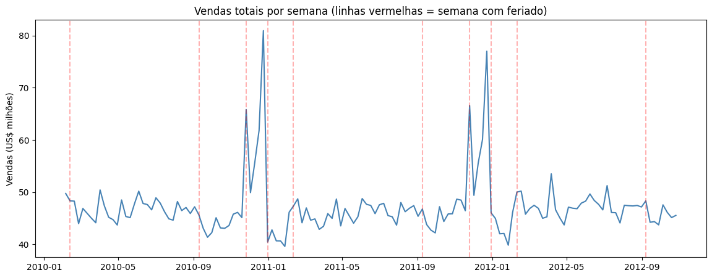
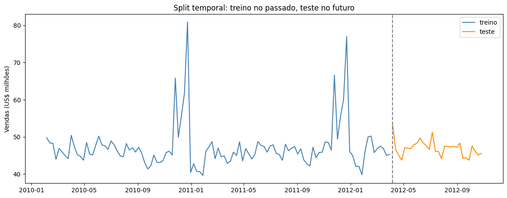
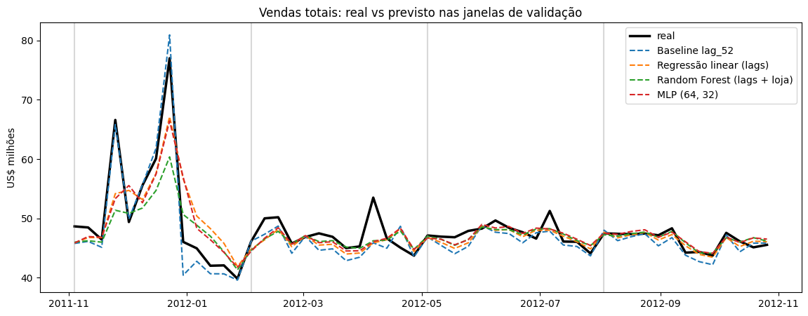
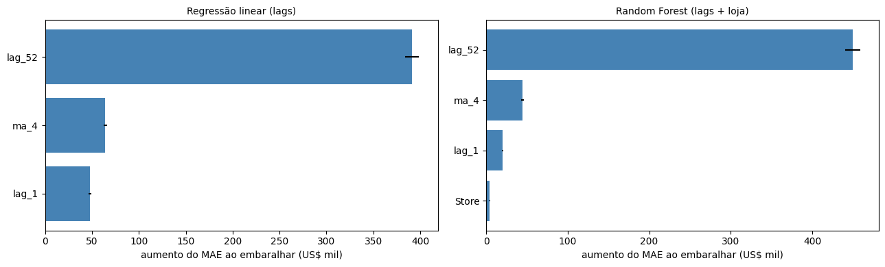

# Previsão de Demanda com Variáveis Externas para a Quantum Commerce

Trabalho final da disciplina Machine Learning Foundations and Classical Models. MBA AI Engineering & Multi-Agents (FIAP). 

## Aluno

* Turma: 4AIER
* Luiz Paulo Prado -  RM377637 
* Renato Romão - RM377019
* Diego Moreira -  RM376480
* Orlando Valverde - RM376801

## Resumo

Propomos prever as vendas semanais de cada loja da Quantum Commerce para antecipar picos de demanda e reduzir custos logísticos. Como não há dados da empresa, usamos como proxy o dataset Walmart (45 lojas, 143 semanas) e tratamos a série de cada loja como um problema de regressão sobre valores passados (lags).

A solução recomendada é híbrida: nas semanas normais, uma regressão linear sobre três lags; nas semanas de pico de fim de ano, a venda da mesma semana do ano anterior. Em validação walk-forward com 4 janelas, o híbrido teve o menor WAPE médio (5,1%, contra 5,6% do baseline mais simples e 5,9% da regressão linear sozinha). Em um alerta de reforço de estoque disparado quando a previsão passa de 1,2 vez o nível normal da loja, ele identificou 82% dos picos reais com 92% de precisão.

Random Forest, Gradient Boosting e MLP ficaram empatados com a regressão linear fora dos picos, então escolhemos o modelo mais fácil de explicar. As variáveis externas (temperatura, combustível, CPI, desemprego e feriado) não melhoraram a previsão. As conclusões vêm de um único pico de fim de ano e de dados dos EUA; a seção 4 lista esses limites.

## 1. Introdução e Problemática

### O desafio escolhido

Entre os desafios do enunciado, escolhemos a **previsão de demanda**: antecipar picos de venda por loja para reduzir custos logísticos. A Quantum Commerce é uma varejista omnicanal presente em 12 países, com mais de 5 milhões de SKUs, e enfrenta o "muro da escalabilidade operacional": decidir estoque, transporte e equipe por métodos tradicionais deixou de funcionar nessa escala.

### Por que ele é relevante

A previsão de demanda alimenta decisões de logística todas as semanas: quanto estoque posicionar em cada loja, quando reforçar o transporte e quando não é preciso. Errar tem dois custos opostos. Prever a menos causa ruptura, com venda perdida e cliente insatisfeito. Prever a mais imobiliza capital em estoque parado.

O risco se concentra nos picos. Nos dados usados aqui, a venda total da rede na semana anterior ao Natal de 2011 foi de aproximadamente US$ 77 milhões, contra algo entre US$ 45 e 50 milhões em semanas comuns (Figura 1; valores lidos do gráfico). Um modelo que acerta bem a semana comum e falha no pico entrega pouco valor para a logística.

### Os dados usados como proxy

Usamos o Walmart Dataset (Retail), do Kaggle: 45 lojas, vendas semanais de 05/02/2010 a 26/10/2012, 143 semanas por loja e 6.435 linhas, sem valores nulos nem linhas duplicadas. Além da venda semanal (`Weekly_Sales`, o alvo), há uma flag de feriado, temperatura, preço do combustível, CPI e taxa de desemprego da região.

A exploração dos dados mostrou o seguinte:

- **Sazonalidade anual forte.** Os picos de fim de ano (Black Friday e semana anterior ao Natal) dominam a série, seguidos de queda em janeiro.
- **Escalas muito diferentes entre lojas.** A venda média semanal varia de US$ 0,26 milhão a US$ 2,11 milhões, uma razão de cerca de 8 vezes.
- **Variáveis externas com relação linear fraca** com a venda (correlação absoluta de até 0,14 com a venda relativa à média da loja).
- **Flag de feriado imprecisa.** Ela marca o Thanksgiving corretamente, mas a flag de Natal cai na semana depois do pico.

*Figura 1. Vendas totais da rede por semana. As linhas vermelhas marcam semanas com `Holiday_Flag` igual a 1.*

Os dados são dos EUA e servem para validar a abordagem. O desempenho na Quantum Commerce precisa ser reconfirmado com os dados da própria empresa.

## 2. Motivação e Justificativa do Modelo

### Como formulamos o problema

Tratamos a série de cada loja como um problema de regressão supervisionada. O alvo é a venda da semana, e as variáveis são valores passados da própria série (lags), sempre calculados por loja e usando apenas informação anterior à semana prevista:

- `lag_1`: venda da semana anterior.
- `lag_52`: venda da mesma semana do ano anterior, que carrega a sazonalidade.
- `ma_4`: média das 4 semanas anteriores, sem incluir a semana atual.

Essa formulação fica dentro do escopo da disciplina (regressão, árvores e ensembles, MLP) e permite um único modelo global para as 45 lojas, o que importa porque cada loja tem poucas semanas de histórico. O custo do `lag_52` é que o primeiro ano de cada loja fica sem valor: sobram 4.095 das 6.435 linhas (64%) para treino e avaliação.

### Alternativas comparadas

Separamos treino e teste por data, nunca ao acaso: o treino vai de 05/02/2010 a 30/03/2012 e o teste são as últimas 30 semanas (06/04/2012 a 26/10/2012). Um split aleatório deixaria o modelo treinar com semanas posteriores às que ele prevê. Todos os modelos usam as mesmas 2.745 linhas completas de treino e as mesmas 1.350 linhas de teste.

*Figura 2. Split temporal: treino no passado, teste no futuro.*

| Modelo | Features | MAE (US$) | WAPE |
|---|---|---|---|
| Baseline: repete a semana passada | `lag_1` | 58.628 | 5,6% |
| Baseline: repete o ano passado | `lag_52` | 59.274 | 5,7% |
| Regressão linear | 3 lags | 47.158 | 4,5% |
| Regressão linear | 3 lags + externas | 47.585 | 4,6% |
| Regressão linear | 3 lags + mês | 51.562 | 4,9% |
| Regressão linear | 3 lags + externas + mês | 50.295 | 4,8% |
| Random Forest | 3 lags + loja | 44.992 | 4,3% |
| Random Forest | todas as features | 45.055 | 4,3% |
| Gradient Boosting | 3 lags + loja | 45.605 | 4,4% |
| Gradient Boosting | todas as features | 47.166 | 4,5% |
| MLP (16) | 3 lags | 47.120 | 4,5% |
| MLP (64) | 3 lags | 46.184 | 4,4% |
| MLP (64, 32) | 3 lags | 44.386 | 4,3% |

*Tabela 1. Resultado no teste de 30 semanas. MAE é o erro médio absoluto por loja e semana; WAPE é a soma dos erros absolutos dividida pela soma das vendas reais.*

O que a Tabela 1 mostra:

- **Os baselines são uma régua alta.** Repetir a semana passada erra 5,6% do volume; repetir o ano passado erra 5,7%.
- **Combinar os dois lags já vence ambos.** A regressão linear chega a 4,5% porque aprende a proporção entre as fontes: pesos de 0,72 para `lag_52`, 0,16 para `ma_4` e 0,13 para `lag_1`, com intercepto próximo de zero. Cada baseline usava só uma das informações.
- **As variáveis externas não ajudaram.** Adicionar temperatura, combustível, CPI, desemprego e feriado piorou 0,1 ponto percentual, o que é ruído. O mês em dummies piorou 0,4 ponto: cada mês de abril a outubro aparece em um único ano no treino, e o modelo decora as particularidades de 2011.
- **Modelos não lineares não mudam o quadro.** Random Forest e Gradient Boosting ficam entre 4,3% e 4,5%, e nas duas famílias as variáveis externas continuam sem ajudar (o Gradient Boosting com todas as features piorou).
- **Os ganhos entre linear, árvores e MLP são de 0,2 ponto ou menos.** Com um único teste de 30 semanas, essa diferença não permite apontar um campeão.

### Modelo clássico contra rede neural

Para a comparação pedida no enunciado, treinamos um MLP com três arquiteturas (16 neurônios; 64; 64 e 32 em duas camadas). As features e o alvo foram normalizados dentro de um `Pipeline`, de modo que média e desvio vêm só do treino. Não usamos `early_stopping`, que separaria parte do treino ao acaso e ignoraria a ordem do tempo, e fixamos a semente.

O melhor MLP (64, 32) atingiu 4,3%, o mesmo WAPE da Random Forest, e a regressão linear ficou em 4,5%. O MLP não ganha de forma que compense o custo: perde a leitura direta dos pesos, exige normalização do alvo e das features, depende de semente e de convergência, e a ordem entre as arquiteturas pode mudar com outra semente. Com poucos dados tabulares e features bem comportadas, a rede neural não traz informação que o modelo linear já não tenha.

### Validação em janelas e o efeito do pico de fim de ano

O teste de 30 semanas cobre abril a outubro e não inclui Black Friday nem Natal, justamente o período que mais importa. Por isso repetimos a comparação com validação walk-forward: 4 janelas de 13 semanas, de 04/11/2011 a 26/10/2012, em que o treino de cada janela contém só o passado dela. O corte é feito sobre as datas, e não sobre as linhas, porque os dados são um painel de lojas e um corte por linhas separaria lojas em vez de tempo. A janela 1 contém Thanksgiving e Natal de 2011, e seu treino (até 28/10/2011) não contém nenhum pico de fim de ano.

| Modelo | Janela 1 (Natal) | Janela 2 | Janela 3 | Janela 4 | Média | Desvio |
|---|---|---|---|---|---|---|
| Baseline `lag_52` | 5,5% | 6,3% | 5,2% | 5,1% | 5,6% | 0,5% |
| MLP (64, 32) | 10,1% | 5,1% | 3,7% | 3,7% | 5,6% | 3,0% |
| Random Forest (3 lags + loja) | 11,0% | 5,1% | 3,7% | 3,8% | 5,9% | 3,5% |
| Regressão linear (3 lags) | 10,4% | 5,5% | 4,0% | 3,8% | 5,9% | 3,1% |
| **Híbrido (linear + `lag_52` no pico)** | 7,1% | 5,5% | 4,0% | 3,8% | **5,1%** | n/d |

*Tabela 2. WAPE por janela de validação. O desvio do híbrido não foi calculado; o híbrido é uma regra definida depois de ver as quatro primeiras linhas (ver abaixo).*

*Figura 3. Vendas totais da rede, real (preto) contra previsto por cada modelo, nas 52 semanas de validação. Cada linha cinza vertical marca o início de uma janela.*

O resultado muda o quadro da seção anterior:

- **No Natal, o baseline simples vence todos os modelos por quase o dobro:** 5,5% contra 10,1% a 11,0%. Nas janelas calmas (3 e 4), os modelos vencem o baseline: 3,7% a 4,0% contra 5,1% a 5,2%. O "campeão" do teste de 30 semanas só valia para períodos sem pico.
- **Na média, os modelos empatam com o baseline** (5,6% a 5,9%), e o desvio entre janelas (3% a 3,5%) é maior que a diferença entre eles.
- **A causa é a forma do erro no pico.** Os modelos achatam o pico (previsto em torno de US$ 67 milhões no Natal na regressão linear e no MLP, e 60 na Random Forest, contra 77 reais) e arrastam um eco nas semanas seguintes (previsto perto de US$ 50 milhões em janeiro, contra 46 reais; valores lidos do gráfico), porque `lag_1` e `ma_4` carregam o pico para a semana seguinte. O viés líquido é pequeno, porque os dois erros se cancelam, mas o WAPE soma ambos. O baseline copia o pico do ano anterior e acerta o formato.
- **Em semanas de feriado, os modelos erram muito mais:** 12,7% a 14,1% contra 5,0% a 5,4% nas normais, enquanto o baseline vai de 5,4% para 6,8%.
- **Uma hipótese, que não conseguimos testar, é que o treino da janela 1 não tinha nenhum pico.** Com mais anos de histórico, o modelo veria vários picos e poderia aprender a confiar no `lag_52` nessa época.

### Escolha do modelo

Escolhemos uma abordagem **híbrida**: regressão linear sobre `lag_1`, `lag_52` e `ma_4` nas semanas normais, e a venda da mesma semana do ano anterior (`lag_52`) de 15 de novembro a 31 de dezembro. As razões:

1. **A regressão linear empata com Random Forest e MLP fora do pico** (3,7% a 4,0% nas janelas 3 e 4), então a complexidade extra não se paga.
2. **Ela é explicável.** A previsão é, em essência, "72% o que a loja vendeu nesta semana ano passado, mais 29% o nível das semanas recentes", e a logística consegue discutir se isso faz sentido. A importância por permutação confirma que o `lag_52` carrega quase todo o sinal (Figura 4).
3. **No pico, a regra simples do ano anterior vence os modelos**, e é a mais fácil de auditar.
4. **O híbrido teve o menor WAPE médio** (5,1%, contra 5,6% do baseline e 5,9% da regressão linear).

Uma ressalva importante: a regra do híbrido foi definida depois de ver os resultados das janelas, com um único pico de fim de ano. Ela é uma proposta fundamentada, e não uma confirmação. Na janela 1 o híbrido ainda erra 7,1% (o baseline puro erra 5,5%), porque as semanas de janeiro, logo depois do pico, usam a regressão e sofrem o eco descrito acima. Não ajustamos a janela de pico para melhorar esse número, para não ajustar a regra duas vezes aos mesmos dados.

## 3. Proposta de Solução

### O modelo

Para cada loja e semana a prever:

- Se a semana está no período de pico (15/11 a 31/12): previsão = venda da mesma semana do ano anterior.
- Caso contrário: previsão = regressão linear de `lag_1`, `lag_52` e `ma_4`. Os pesos aprendidos no treino da Tabela 1 foram 0,13, 0,72 e 0,16, com intercepto próximo de zero. Um único modelo global atende as 45 lojas, e os pesos são reestimados a cada retreino.

Em produção, o calendário de picos seria definido por país, porque o fim de ano pode não ser o pico principal em todos os 12 mercados da Quantum Commerce.

### Dados necessários

- **Mínimo:** histórico semanal de vendas por loja, com pelo menos dois anos (um para o `lag_52` e outro para treinar).
- **Calendário de picos por país.** Um calendário de eventos também permitiria tratar feriados móveis, como a Páscoa, que o `lag_52` não alinha.
- **Variáveis externas são opcionais.** Neste estudo não melhoraram a previsão, então a primeira versão não depende delas.

### Pipeline de treinamento e validação

1. **Preparação:** converter a data com o formato explícito (dia-mês-ano), ordenar por loja e data e conferir que cada loja tem semanas consecutivas, sem falhas.
2. **Features:** calcular os lags sempre dentro de cada loja (agrupando por loja), e a média móvel com deslocamento de uma semana, para que nenhuma feature use a venda da semana prevista.
3. **Split temporal:** treino no passado, teste no futuro. Nenhuma normalização ou ajuste usa dados do teste.
4. **Validação walk-forward:** janelas que avançam no tempo, cortadas sobre as datas, para medir a estabilidade e não depender de um único período.
5. **Retreino periódico** com os dados mais recentes, e comparação contra os dois baselines a cada ciclo. Se o modelo deixar de vencer a regra simples, ele não entra em produção.

### Métricas de avaliação

- **WAPE:** soma dos erros absolutos dividida pela soma das vendas reais. Mede o erro como porcentagem do volume e é fácil de explicar ao negócio. É preferível ao erro percentual médio porque este explode em lojas e semanas de venda baixa.
- **MAE em dólares por loja e semana,** para traduzir o erro em custo operacional.
- **Viés com sinal** (previsto menos real, relativo ao real), para detectar subestimação sistemática.
- **Recall e precisão do alerta de pico** (descritos abaixo), porque a decisão da logística é discreta.

Medimos o erro do híbrido nas quatro janelas de validação:

| Semanas | Venda média por loja-semana | Erro médio por loja-semana | WAPE |
|---|---|---|---|
| Todas | US$ 1.067.681 | US$ 54.895 | 5,1% |
| Pico (15/11 a 31/12) | US$ 1.273.367 | US$ 72.931 | 5,7% |
| Normais | US$ 1.035.685 | US$ 52.089 | 5,0% |

*Tabela 3. Erro do híbrido em dólares na validação.*

O WAPE no pico é parecido com o das semanas normais, mas o erro em dólares por loja é cerca de 40% maior, porque o volume é maior. Somando a rede inteira, o erro semanal médio é de US$ 1,60 milhão (3,3% da venda), porque erros de lojas diferentes se cancelam. A logística, porém, opera loja a loja, então o número relevante é a soma dos erros por loja: US$ 2,47 milhões por semana.

*Figura 4. Importância por permutação: aumento do MAE no teste de 30 semanas ao embaralhar cada feature. O MAE de referência é de cerca de US$ 47 mil.*

Sem o `lag_52`, o erro sobe de 8 a 10 vezes (US$ 391 mil na regressão linear e US$ 450 mil na Random Forest). `ma_4` e `lag_1` aparecem em seguida, e a identificação da loja pesa pouco (US$ 4 mil na Random Forest), porque o tamanho da loja já está embutido nos lags.

### Como o resultado seria consumido na Quantum Commerce

O modelo roda como um processo semanal, depois do fechamento das vendas da semana anterior, e gera uma tabela com a previsão de cada loja para a semana seguinte. A logística consome essa tabela de duas formas:

- **Planejamento:** a previsão por loja entra no cálculo de reposição e de capacidade de transporte.
- **Alerta de pico:** se a venda prevista de uma loja passa de X vezes a média das suas 52 semanas anteriores, dispara o alerta de reforço de estoque. O limite X é uma decisão de negócio, que depende do custo de uma ruptura em comparação com o de um excesso de estoque.

Simulamos o alerta na validação. Um "pico real" é uma semana em que a venda ficou acima de X vezes a média das 52 semanas anteriores. O recall é a fração dos picos reais que o alerta pegou, e a precisão é a fração dos alertas que eram picos de verdade.

| Limite X | Picos reais | Linear: recall / precisão | Híbrido: recall / precisão |
|---|---|---|---|
| 1,1× | 310 | 55% / 67% | 55% / 82% |
| 1,2× | 147 | 56% / 68% | 82% / 92% |
| 1,3× | 97 | 45% / 85% | 89% / 91% |

*Tabela 4. Alerta de pico na validação (4 janelas, 45 lojas).*

O limite define também o que conta como pico real, então a tabela não é um simples compromisso entre recall e precisão: com 1,1× entram altas de 10% a 20%, que ficam dentro do ruído do modelo (erro de cerca de 5%). Sugerimos **1,2×**: no híbrido, ele cobre cerca de 121 picos reais com cerca de 10 alarmes falsos, contra cerca de 86 picos e 9 falsos em 1,3×. Em 1,2×, a regressão linear sozinha pega só 56% dos picos, e o híbrido pega 82%. Esse é o resultado que justifica o híbrido na prática. O limite final deve ser calibrado com os custos reais da Quantum Commerce.

## 4. Considerações e Potencial de Impacto

### Limitações e riscos

- **Dados proxy dos EUA, com 45 lojas.** A Quantum Commerce opera em 12 países, com calendários e picos diferentes. Validamos a abordagem, e não o desempenho esperado na empresa.
- **Histórico curto.** São 143 semanas (2,7 anos), com um único pico de fim de ano na validação e nenhum pico no treino da janela do Natal.
- **Regra do híbrido definida depois de ver os resultados.** É evidência fraca: precisa ser validada em outros picos.
- **Granularidade.** A previsão é por loja e semana, sem produto, categoria ou região, que o desafio do enunciado cita. Com mais de 5 milhões de SKUs, a previsão por SKU é um problema à parte.
- **Variáveis externas.** Não ajudaram e, no teste, usamos os valores reais da semana, um cenário otimista: na prática, a temperatura ou o CPI da semana seguinte seriam previsões.
- **Feriados móveis.** A Páscoa muda de semana entre anos e o `lag_52` alinha pela semana do ano, e não pelo evento: nas lojas 20 e 34, o pico de 06/04/2012 foi previsto duas semanas depois. A `Holiday_Flag` do dataset também não marca a Páscoa.
- **Crescimento anual.** O viés negativo do baseline em todas as janelas (de 1,5% a 3,3%) sugere um crescimento de 2% a 3% ao ano que o `lag_52` não enxerga.
- **Lojas com erro persistente.** As lojas 36, 14, 38, 39 e 35 aparecem entre as piores (a 36 erra 14,2% na regressão linear e 22,0% no baseline). Elas têm tamanho e volatilidade parecidos com as demais, e não encontramos a causa.
- **Horizonte de uma semana.** Cada previsão usa a venda já observada da semana anterior. Planejar com mais semanas de antecedência exigiria prever vários passos à frente, o que não testamos.
- **Ganho modesto sobre a regra simples.** O híbrido tem 5,1% de WAPE médio contra 5,6% do baseline `lag_52`, e a diferença é pequena perto do desvio entre janelas. O valor principal é operacional.
- **Sem monitoramento nem retreino definidos.** A proposta de pipeline os prevê, mas não foram implementados.

### Potencial de valor

O valor esperado está em substituir reação por antecipação na logística: abastecer e escalar cada loja antes do pico, em vez de depois dele. Com o erro medido (cerca de US$ 55 mil por loja e semana, sobre uma venda média de US$ 1,07 milhão) e o alerta de 1,2× pegando 82% dos picos reais, a logística passa a ter um sinal acionável com uma semana de antecedência. O ganho financeiro exato depende de dois custos que não temos: o de uma ruptura e o de um excesso de estoque. Por isso não estimamos um valor em dólares. O próximo passo para isso é levantar esses custos e simular, com o histórico da empresa, quanto o alerta teria economizado.

### Evolução futura

- **Mais histórico e vários picos.** É o caminho mais direto para o modelo aprender a confiar no `lag_52` no fim de ano e para validar a regra do híbrido em picos diferentes, sem ajustá-la aos mesmos dados.
- **Calendário de eventos por país,** incluindo feriados móveis.
- **Maior granularidade:** previsão por categoria e região. A clusterização de lojas com perfis parecidos pode ajudar onde cada série tem pouco histórico.
- **Investigação das lojas difíceis** (36, 14, 38, 39 e 35).
- **Modelos de redes recorrentes e Transformers,** temas da disciplina seguinte, podem ser explorados depois, apenas como evolução futura. Esta proposta não depende deles.

## Anexo: reprodutibilidade

Todo o trabalho foi feito no notebook `previsao_demanda.ipynb`, na mesma pasta, com uma seção por etapa e as conclusões de cada uma. Os modelos usam semente fixa (`random_state=42`) e nenhum hiperparâmetro foi ajustado olhando o teste. Os dados vêm do Kaggle: [Walmart Dataset (Retail)](https://www.kaggle.com/datasets/rutuspatel/walmart-dataset-retail).
